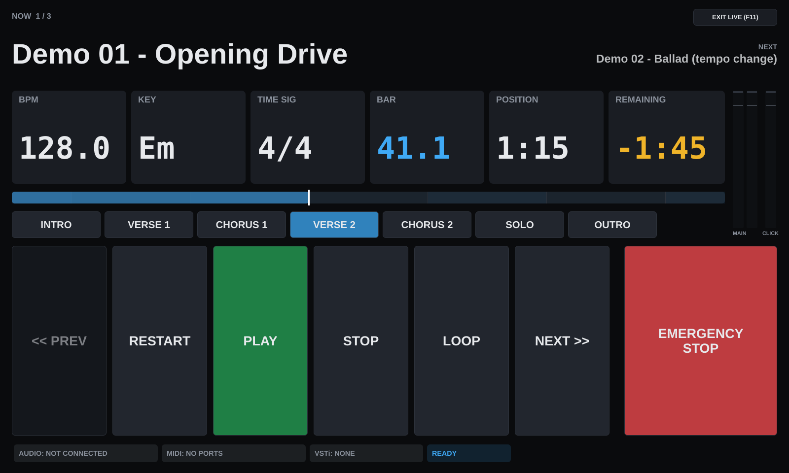

# B4ND LIVE MTR

AI Song Analyzer + Hybrid MIDI/VSTi + Professional Live MTR.
B4ND(기타·베이스·드럼·보컬 + 곡에 따라 키보드) 카피 공연을 위한 Windows 전용 멀티트랙 재생 프로그램입니다.
**기능 개수보다 실제 공연 중 끊김 없는 재생을 최우선**으로 합니다.

## 설계 문서

| # | 문서 |
|---|------|
| 01 | [시스템 아키텍처](docs/01-system-architecture.md) |
| 02 | [전체 폴더 구조](docs/02-folder-structure.md) |
| 03 | [오디오 엔진 구조](docs/03-audio-engine.md) |
| 04 | [MIDI 라우팅 구조](docs/04-midi-routing.md) |
| 05 | [VST3 Host 구조](docs/05-vst3-host.md) |
| 06 | [Audio Routing 설계도](docs/06-audio-routing.md) |
| 07 | [AI 분석 모델 선정](docs/07-ai-model-selection.md) |
| 08 | [데이터베이스 설계](docs/08-database-design.md) |
| 09 | [단계별 개발 계획](docs/09-development-plan.md) |
| 10 | [테스트 계획](docs/10-test-plan.md) |

## 현재 상태: Phase 2 (오디오 인터페이스 및 ASIO 엔진)

- 다크 테마 메인 화면: 상단 트랜스포트/BPM/Key/박자, 좌측 프로젝트·AI 메뉴, 중앙 멀티트랙 타임라인, 하단 믹서·8채널 출력 미터·장치 상태
- 전체 화면 공연 모드 (F11)
- `b4nd_core`: 템포맵(템포·박자 변경), 클릭 보호 출력 라우팅 (+ 단위 테스트)
- 오디오 장치(ASIO 우선) 선택·설정, 장치 분리 감지와 같은 장치 재연결, 공연 전 출력 테스트(상태바 클릭 또는 Ctrl+,)
- 트랜스포트는 오디오 샘플 클럭으로 동작합니다. 곡 오디오 재생은 Phase 3부터이며, 장치가 없으면 화면 확인용 가상 트랜스포트로 동작합니다.
- 곡 목록은 데모 데이터입니다.




### 단축키

| 키 | 동작 |
|----|------|
| Space | 재생 / 일시정지 |
| Esc | 비상 정지 |
| Home | 처음으로 |
| Enter | 정지 |
| PageDown / PageUp | 다음 곡 / 이전 곡 |
| → | 다음 큐 포인트 |
| L | 루프 |
| F11 | 공연 모드 전환 |
| Ctrl+, | 오디오 설정 |

## 빌드 (Windows 10/11 x64)

필요: Visual Studio 2022 (C++ 데스크톱 개발), CMake 3.22+, Git. JUCE 8.0.9는 CMake가 자동으로 받습니다.

```bat
cmake --preset windows-msvc
cmake --build --preset windows-msvc
ctest --test-dir build/windows -C Release
"build\windows\src\app\B4ND_LIVE_MTR_artefacts\Release\B4ND LIVE MTR.exe"
```

ASIO 사용 (Phase 2부터 필요): Steinberg 사이트에서 ASIO SDK를 받아 압축을 풀고,

```bat
set B4ND_ASIO_SDK_DIR=C:\SDK\asiosdk
cmake --preset windows-msvc-asio
cmake --build --preset windows-msvc-asio
```

GitHub Actions가 매 push/PR마다 Windows(MSVC)와 Linux에서 빌드·테스트하고, Windows 실행 파일과 UI 스크린샷을 Artifact로 올립니다.

## 라이선스 메모

JUCE는 AGPLv3/상용 이중 라이선스입니다. 밴드 내부 사용은 문제없지만 외부 배포 시 검토가 필요합니다. ASIO SDK는 JUCE에 포함되지 않으며 Steinberg 조건에 따라 별도로 받아야 합니다. AI 모델별 라이선스는 [07 문서](docs/07-ai-model-selection.md)를 참고하세요.
