# B4ND LIVE MTR

AI Song Analyzer + Hybrid MIDI/VSTi + Professional Live MTR.
B4ND(기타·베이스·드럼·보컬 + 곡에 따라 키보드) 카피 공연을 위한 Windows 전용 멀티트랙 재생 프로그램입니다.
**기능 개수보다 실제 공연 중 끊김 없는 재생을 최우선**으로 합니다.

## 설계 문서

| # | 문서 |
|---|------|
| 01 | [시스템 아키텍처](docs/01-system-architecture.md) |
| 02 | [전체 폴더 구조](docs/02-folder-structure.md) |
| 03 | [오디오 엔진 구조](docs/03-audio-engine.md) |
| 04 | [MIDI 라우팅 구조](docs/04-midi-routing.md) |
| 05 | [VST3 Host 구조](docs/05-vst3-host.md) |
| 06 | [Audio Routing 설계도](docs/06-audio-routing.md) |
| 07 | [AI 분석 모델 선정](docs/07-ai-model-selection.md) |
| 08 | [데이터베이스 설계](docs/08-database-design.md) |
| 09 | [단계별 개발 계획](docs/09-development-plan.md) |
| 10 | [테스트 계획](docs/10-test-plan.md) |

## 현재 상태: Phase 8 (AI 분석: BPM, Key, 코드, 구조)

- 다크 테마 메인 화면: 상단 트랜스포트/BPM/Key/박자, 좌측 프로젝트·AI 메뉴, 중앙 멀티트랙 타임라인, 하단 믹서·8채널 출력 미터·장치 상태
- 전체 화면 공연 모드 (F11)
- `b4nd_core`: 템포맵(템포·박자 변경), 클릭 보호 출력 라우팅 (+ 단위 테스트)
- 오디오 장치(ASIO 우선) 선택·설정, 장치 분리 감지와 같은 장치 재연결, 공연 전 출력 테스트(상태바 클릭 또는 Ctrl+,)
- 오디오 파일(WAV/AIFF/FLAC/MP3)을 타임라인에 끌어다 놓으면 트랙이 되고, 재생 전에 RAM으로 미리 불러옵니다
- 클릭은 템포맵을 따라 생성되며 클릭/가이드는 PA 출력에 절대 나가지 않습니다
- 출력 2개 장치(UR22C 등)는 자동으로 OUT1 = MR 모노(PA), OUT2 = 클릭+가이드(인이어)로 나뉩니다
- 트랜스포트는 오디오 샘플 클럭으로 동작합니다. 장치가 없으면 화면 확인용 가상 트랜스포트로 동작합니다.
- 프로젝트는 `<이름>.b4nd` 폴더(SQLite `project.db`)로 저장되며, 변경 5초 후 자동 저장, 30분마다 백업, 비정상 종료 감지, 시작 시 마지막 프로젝트 자동 열기를 지원합니다
- 프로젝트가 없으면 데모 곡 목록이 표시됩니다
- 외부 MIDI 음원 모듈: 좌측 MIDI MODULES 버튼이나 Ctrl+M으로 모듈을 등록합니다. 포트, 채널, Bank/Program, 볼륨/팬, 지연 보정을 설정하고 TEST NOTE로 확인합니다
- 포트를 1초마다 확인합니다. 분리되면 빨간색으로 표시하고, 다시 꽂으면 자동으로 다시 열어 프리셋을 재전송합니다
- `.mid` 파일을 타임라인에 끌어다 놓으면 외부 MIDI 트랙이 됩니다. 정지, 이동, 비상 정지, 장치 분리 때는 Note Off와 All Notes Off를 보내 음이 걸리지 않게 합니다
- VST3 악기: 좌측 PLUGINS 버튼이나 Ctrl+P로 플러그인을 스캔합니다. 플러그인마다 별도 스캐너 프로그램(`b4nd_plugin_scanner.exe`, 앱 옆에 있어야 함)에서 로드하므로, 스캔 중 죽는 플러그인은 앱을 죽이지 않고 블랙리스트에 오릅니다
- 검사를 통과한 플러그인은 LIVE CERTIFIED, 아닌 것은 NOT CERTIFIED(리허설용, 공연 모드에서 경고)로 표시됩니다
- VSTi 트랙에 플러그인을 지정하고 `.mid` 파일을 끌어다 놓으면 연주합니다. EDIT로 플러그인 화면을 엽니다 (공연 모드에서는 닫힘). 플러그인 설정은 프로젝트 DB에 저장되고, 다른 PC에 플러그인이 없으면 PLUGIN MISSING으로 표시하되 설정은 지우지 않습니다

- 외부 모듈의 MIDI 시각은 콜백 지터를 걸러 낸 오디오 시계로 계산합니다. 지연이 큰 모듈은 그만큼 미리 보냅니다
- MIDI Clock: 모듈 프로필에서 "Send MIDI Clock"을 켜면 Start/Stop/Continue/Song Position과 템포를 따르는 클럭을 보냅니다
- 곡 중간으로 이동하거나 일시정지 후 다시 재생하면, 그 위치의 음색(Program/CC)과 길게 눌려 있어야 할 음을 다시 보냅니다
- 지연이 있는 VSTi는 MIDI를 그만큼 먼저 받아 소리가 MR과 맞습니다 (PDC)
- 지연 측정: 오디오 설정 창(Ctrl+,) LATENCY에서 인이어 출력을 입력에 케이블로 연결하고 Measure Round Trip. 그다음 MIDI MODULES 창에서 모듈 출력을 입력에 연결하고 MEASURE DELAY를 누르면 모듈 지연이 Delay ms에 기록됩니다. 측정 틱은 PA 출력으로 나가지 않고, 정지 중에만 동작합니다

- PA(Main) 출력에는 -0.3 dBFS 리미터가 기본으로 걸려 있습니다. 마스터 스트립의 LIM으로 끄고 켜며(공연 모드에서는 잠김), CLIP은 Main 믹스가 0 dBFS를 넘었을 때 켜집니다
- 상단 CLICK 버튼: 곡마다 카운트인(0/1/2/4마디), 8분·16분 분할, 첫 박 악센트, 음색(Beep/Wood/Stick)을 고릅니다. 카운트인 중에는 BAR . BEAT 칸에 COUNT-IN이 표시됩니다
- 외부 모듈의 오디오 출력을 오디오 인터페이스 입력에 연결했다면 MIDI MODULES 창의 Audio return에서 그 입력을 고르세요. 믹서에 RETURN 스트립이 생기고 PA로 나갑니다

- AI 분석: 좌측 AI ANALYSIS의 BPM / Beat / Key 등을 누르거나 Ctrl+Shift+A로 엽니다.
  - 곡의 MR 트랙을 분석해 BPM, 마디 1 위치, 박자, Key, 코드, 구간(Intro/Verse/Chorus...)을 신뢰도와 함께 보여 줍니다.
  - 결과는 초안입니다. 고친 뒤 APPLY TO SONG을 눌러야 곡에 들어가고, UNDO APPLY로 되돌릴 수 있습니다.
  - 분석기는 앱 옆의 `b4nd-analyzer` 폴더(Windows 빌드에 포함, Python 불필요)나 Python 3 + numpy + scipy로 실행됩니다. 공연 모드에서는 쓸 수 없습니다.

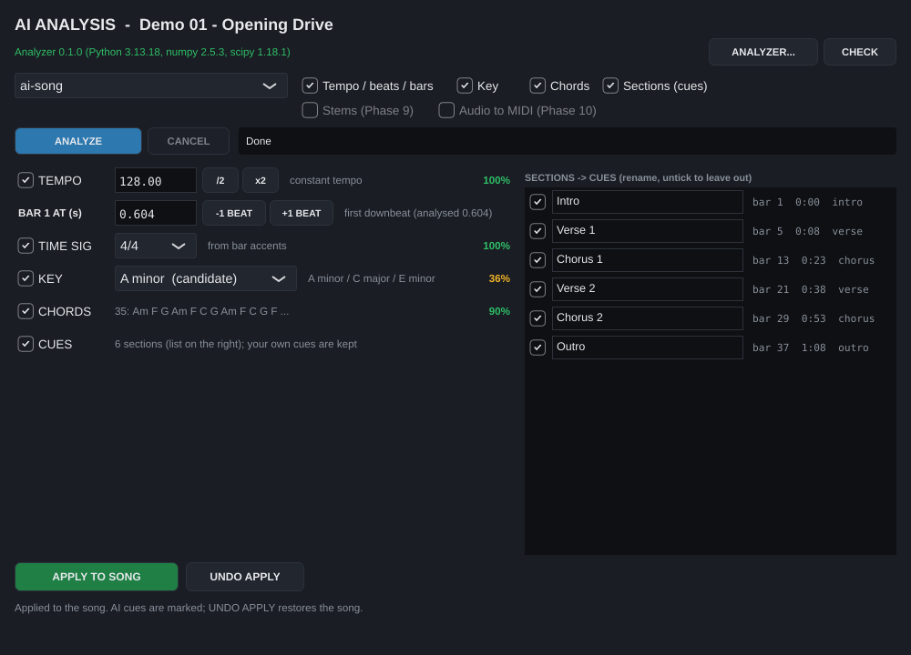

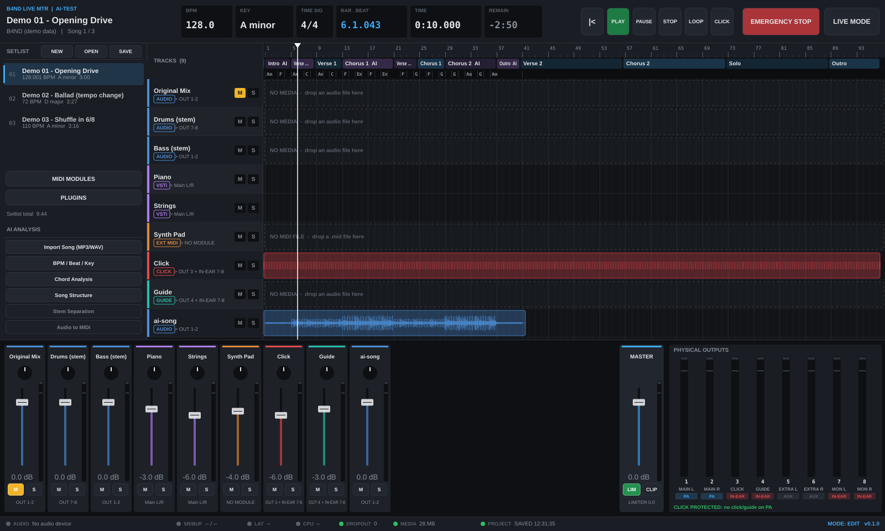

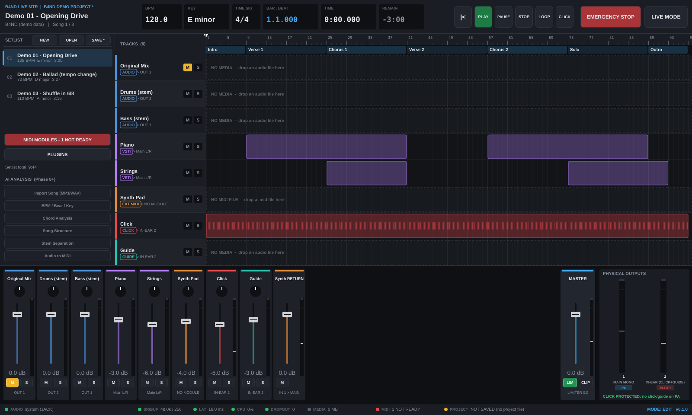

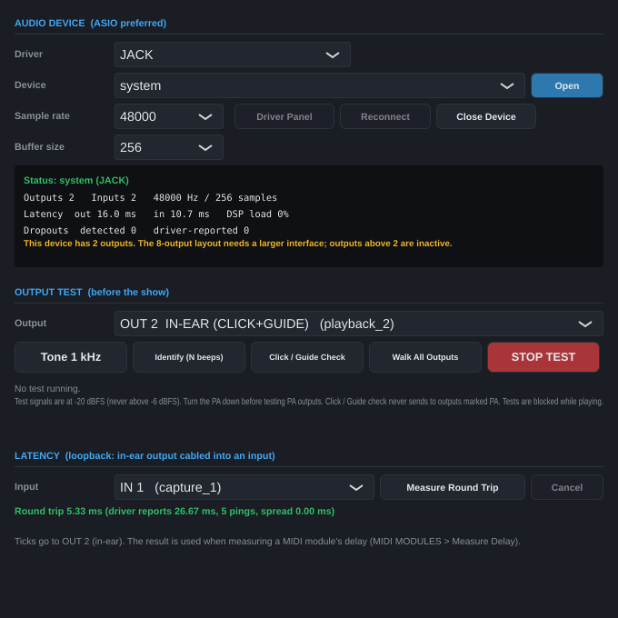

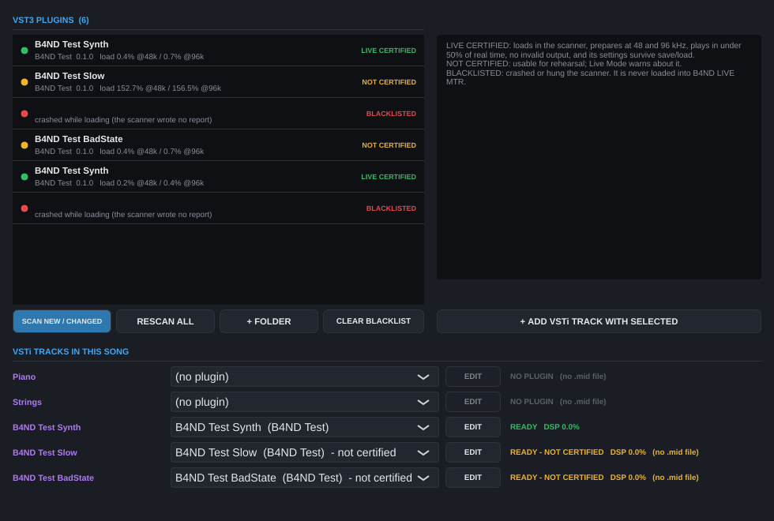

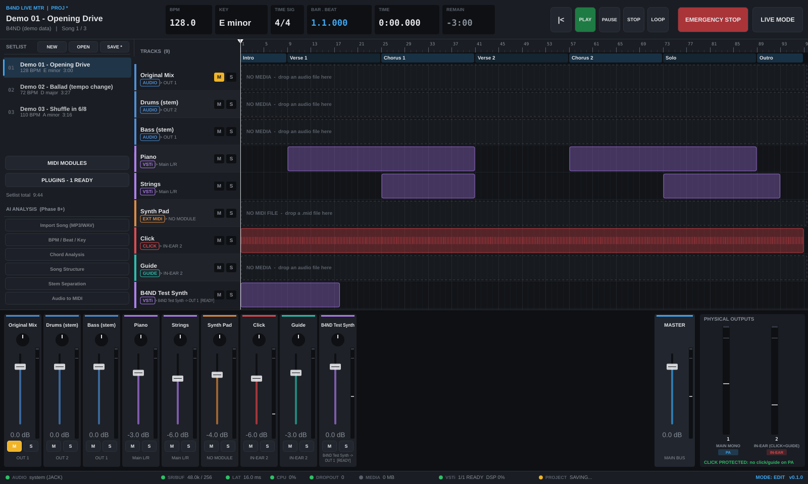

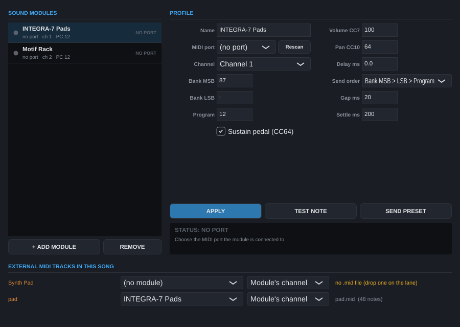

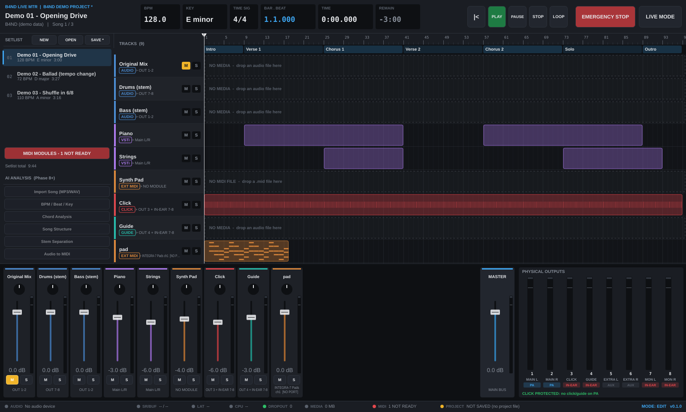

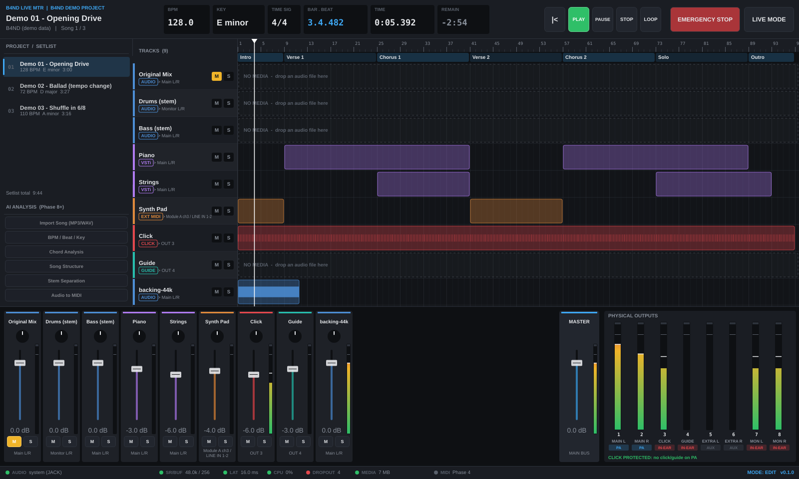

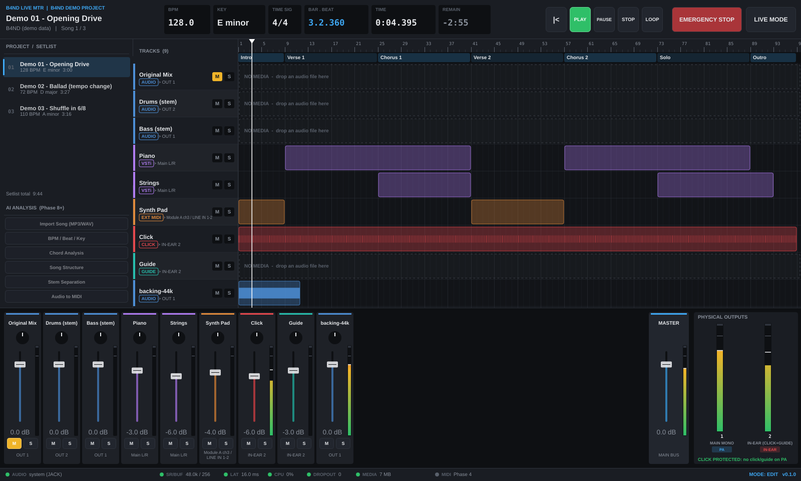

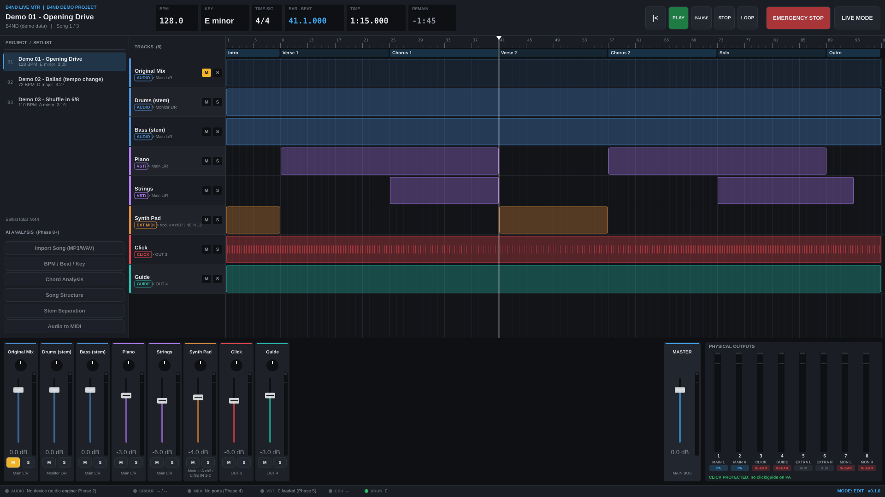


### 단축키

| 키 | 동작 |
|----|------|
| Space | 재생 / 일시정지 |
| Esc | 비상 정지 |
| Home | 처음으로 |
| Enter | 정지 |
| PageDown / PageUp | 다음 곡 / 이전 곡 |
| → | 다음 큐 포인트 |
| L | 루프 |
| F11 | 공연 모드 전환 |
| Ctrl+, | 오디오 설정 |
| Ctrl+M | MIDI 음원 모듈 |
| Ctrl+P | VST3 플러그인 |
| Ctrl+Shift+A | AI 분석 |
| Ctrl+S / Ctrl+Shift+S | 저장 / 다른 이름으로 저장 |
| Ctrl+O / Ctrl+N | 프로젝트 열기 / 새 프로젝트 |

## 빌드 (Windows 10/11 x64)

필요: Visual Studio 2022 (C++ 데스크톱 개발), CMake 3.22+, Git. JUCE 8.0.9는 CMake가 자동으로 받습니다.

```bat
cmake --preset windows-msvc
cmake --build --preset windows-msvc
ctest --test-dir build/windows -C Release
"build\windows\src\app\B4ND_LIVE_MTR_artefacts\Release\B4ND LIVE MTR.exe"
```

ASIO 사용 (Phase 2부터 필요): Steinberg 사이트에서 ASIO SDK를 받아 압축을 풀고,

```bat
set B4ND_ASIO_SDK_DIR=C:\SDK\asiosdk
cmake --preset windows-msvc-asio
cmake --build --preset windows-msvc-asio
```

GitHub Actions가 매 push/PR마다 Windows(MSVC)와 Linux에서 빌드·테스트하고, Windows 실행 파일(단독 실행 분석기 포함)과 UI 스크린샷을 Artifact로 올립니다.

분석기만 따로 테스트하려면: `cd analyzer && python -m unittest discover -s tests -t .` (numpy, scipy 필요)

## 라이선스 메모

JUCE는 AGPLv3/상용 이중 라이선스입니다. 밴드 내부 사용은 문제없지만 외부 배포 시 검토가 필요합니다. ASIO SDK는 JUCE에 포함되지 않으며 Steinberg 조건에 따라 별도로 받아야 합니다. AI 모델별 라이선스는 [07 문서](docs/07-ai-model-selection.md)를 참고하세요.
